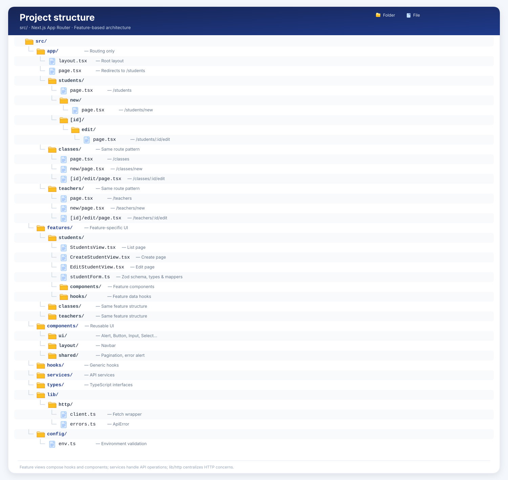

# School Management System

Full-stack app: Express + MongoDB (Atlas) API and Next.js frontend.

## Project Structure

## Live

- Frontend: https://school-management-system-theta-ten.vercel.app
- API: https://school-api-q69s.onrender.com/api/health
  (free tier: first request may take up to a minute)

## Structure

- `backend/` Express 5 + Mongoose API
- `frontend/` Next.js (App Router) + React Hook Form + Zod

## Run locally

1. `cd backend && cp .env.example .env` (fill MONGODB_URI) -> `npm install && npm run dev`
2. `cd frontend && cp .env.example .env.local` -> `npm install && npm run dev`
3. Seed (optional): `npm run seed:teachers && npm run seed:classes && npm run seed:students`

## Environment variables

| Where    | Name                | Purpose                                     |
| -------- | ------------------- | ------------------------------------------- |
| backend  | MONGODB_URI         | Atlas connection string                     |
| backend  | CORS_ORIGIN         | Allowed frontend origin(s), comma separated |
| frontend | NEXT_PUBLIC_API_URL | API base URL                                |

## Folder structure

src/
├── app/ # Routing only
│ ├── layout.tsx # Root layout
│ ├── page.tsx # Redirects to /students
│ ├── students/
│ │ ├── page.tsx
│ │ ├── new/
│ │ │ └── page.tsx
│ │ └── [id]/
│ │ └── edit/
│ │ └── page.tsx
│ ├── classes/
│ │ ├── page.tsx
│ │ ├── new/page.tsx
│ │ └── [id]/edit/page.tsx
│ └── teachers/
│ ├── page.tsx
│ ├── new/page.tsx
│ └── [id]/edit/page.tsx
│
├── features/ # Feature-specific UI
│ ├── students/
│ │ ├── StudentsView.tsx
│ │ ├── CreateStudentView.tsx
│ │ ├── EditStudentView.tsx
│ │ ├── studentForm.ts
│ │ ├── components/
│ │ └── hooks/
│ ├── classes/
│ └── teachers/
│
├── components/ # Reusable UI
│ ├── ui/
│ ├── layout/
│ └── shared/
│
├── hooks/ # Generic hooks
├── services/ # API services
├── types/ # TypeScript interfaces
├── lib/
│ └── http/
│ ├── client.ts
│ └── errors.ts
│
└── config/
└── env.ts # Environment validation
