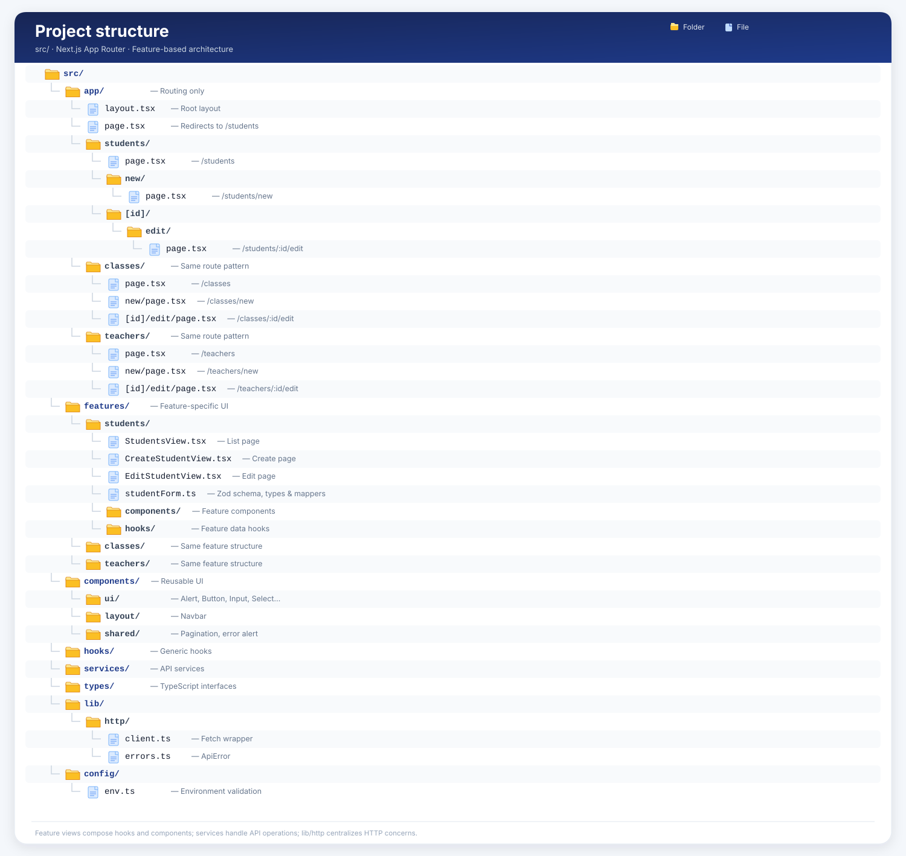

# School Management System

Full-stack app: Express + MongoDB (Atlas) API and Next.js frontend.

## Project Structure



## Live

- Frontend: https://school-management-system-theta-ten.vercel.app
- API: https://school-api-q69s.onrender.com/api/health
  (free tier: first request may take up to a minute)

## Structure

- `backend/` Express 5 + Mongoose API
- `frontend/` Next.js (App Router) + React Hook Form + Zod

## Run locally

1. `cd backend && cp .env.example .env` (fill MONGODB_URI) -> `npm install && npm run dev`
2. `cd frontend && cp .env.example .env.local` -> `npm install && npm run dev`
3. Seed (optional): `npm run seed:teachers && npm run seed:classes && npm run seed:students`

## Environment variables

| Where    | Name                | Purpose                                     |
| -------- | ------------------- | ------------------------------------------- |
| backend  | MONGODB_URI         | Atlas connection string                     |
| backend  | CORS_ORIGIN         | Allowed frontend origin(s), comma separated |
| frontend | NEXT_PUBLIC_API_URL | API base URL                                |

## Folder structure

```
src/
├── app/                          # ROUTING ONLY: thin pages, no logic
│   ├── layout.tsx                # Root layout (Navbar + main container)
│   ├── page.tsx                  # Redirects "/" to "/students"
│   ├── students/
│   │   ├── page.tsx              # /students
│   │   ├── new/page.tsx          # /students/new
│   │   └── [id]/edit/page.tsx    # /students/:id/edit
│   ├── classes/                  # same three routes
│   └── teachers/                 # same three routes
│
├── features/                     # FEATURE UI: one folder per domain
│   ├── students/
│   │   ├── StudentsView.tsx      # List page: filters, table, pagination, delete
│   │   ├── CreateStudentView.tsx
│   │   ├── EditStudentView.tsx
│   │   ├── studentForm.ts        # Zod schema, form types, form<->API mappers
│   │   ├── components/           # StudentForm, StudentFilters, StudentsTable
│   │   └── hooks/                # useStudents (list), useStudent (one)
│   ├── classes/                  # same shape, plus useClassOptions (dropdown data)
│   └── teachers/                 # same shape, plus useTeacherOptions (dropdown data)
│
├── components/                   # REUSABLE UI: knows nothing about the domain
│   ├── ui/                       # Alert, Button, FormField, Input, Select,
│   │                             # SelectField, TextField
│   ├── layout/                   # Navbar
│   └── shared/                   # PaginationControls, ServerErrorAlert
│
├── hooks/                        # GENERIC HOOKS: useDebounce, useFormSubmit
├── services/                     # API CALLS: student/class/teacher .service.ts
├── types/                        # INTERFACES: api.ts, student.ts, class.ts, teacher.ts
├── lib/
│   └── http/                     # fetch wrapper (client.ts) + ApiError (errors.ts)
└── config/
    └── env.ts                    # Reads and validates environment variables
```
